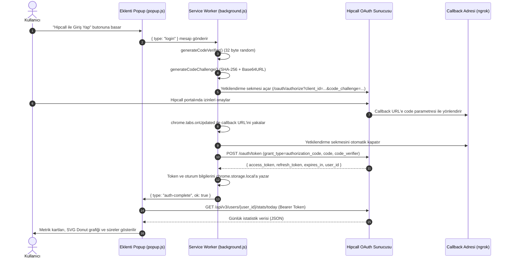

# Hipcall Today Stats & Site Inspector (Chrome Eklentisi - Manifest V3)

Bu proje, Hipcall API v3 ile entegre çalışan, kullanıcıların günlük çağrı ve durum istatistiklerini grafiksel olarak sunan ve aktif açık web sekmelerinden kurumsal iletişim bilgilerini (domain, URL, e-posta, telefon, adres) toplayan bir Google Chrome eklentisidir.

Manifest V3 standartlarına tam uyumlu olarak Vanilla HTML5, CSS3 ve modern JavaScript ile geliştirilmiştir. Herhangi bir harici kütüphane veya paketleyici (webpack, vite vb.) bağımlılığı bulunmamaktadır.

---

## İçindekiler

- [Temel Özellikler](#temel-özellikler)
- [Mimari ve Güvenlik Modeli](#mimari-ve-güvenlik-modeli)
- [Modüller ve İşlevleri](#modüller-ve-i̇şlevleri)
  - [1. Hipcall Günlük İstatistikleri](#1-hipcall-günlük-i̇statistikleri)
  - [2. Aktif Site Dedektifi (Lead Scraper)](#2-aktif-site-dedektifi-lead-scraper)
- [OAuth 2.0 PKCE Akış Şeması](#oauth-20-pkce-akış-şeması)
- [Proje Dosya Yapısı](#proje-dosya-yapısı)
- [Kurulum ve Çalıştırma](#kurulum-ve-çalıştırma)
- [Yapılandırma Kılavuzu](#yapılandırma-kılavuzu)
- [Kullanılan API Uç Noktaları](#kullanılan-api-uç-noktaları)

---

## Temel Özellikler

- **Chrome Manifest V3 Desteği:** Service Worker tabanlı arka plan yönetimi ve `chrome.scripting` API kullanımı.
- **RFC 7636 PKCE Güvenliği:** İstemci tarafında `client_secret` tutulmadan S256 hash doğrulaması ile yetkilendirme.
- **Otomatik Oturum Yönetimi:** Yönlendirme sekmesinin otomatik tespiti ve kapatılması, `chrome.storage.local` üzerinde güvenli token saklama ve proaktif/reaktif token yenileme (`refresh_token`).
- **Veri Görselleştirme:** Günlük 24 saatlik durum dağılımını gösteren SVG Donut halka grafiği ve orantısal yatay zaman çubuğu.
- **Türkçe Formatlama:** Saniyelerin saat/dakika formatına (`X sa Y dk` ve `HH:MM:SS`) ve ISO tarihlerin yerel Türkçe formata dönüştürülmesi.
- **11 Kademeli DOM Scraper:** Açık olan herhangi bir siteden karmaşık footer veya dinamik yapılardaki iletişim bilgilerini (e-posta, telefon, adres) ayrıştıran algoritma.
- **Tek Tıkla Kopyalama:** Çıkarılan iletişim verilerinin Clipboard API ile tek tıkla kopyalanabilmesi.

---

## Mimari ve Güvenlik Modeli

### 1. OAuth 2.0 PKCE (Proof Key for Code Exchange)
Tarayıcı eklentileri genel dağıtıma açık (public client) yazılımlar olduğu için kod tabanında gizli anahtar (`client_secret`) saklanamaz. Hipcall yetkilendirmesi RFC 7636 standardına uygun olarak PKCE ile gerçekleştirilir:
1. `crypto.getRandomValues` ile 32 baytlık kriptografik rastgele `code_verifier` üretilir.
2. Bu değer Web Crypto API (`crypto.subtle.digest`) ile SHA-256 algoritmasından geçirilip Base64URL formatında `code_challenge` haline getirilir.
3. Sunucuya istek yapılırken `code_challenge` ve `code_challenge_method=S256` iletilir.
4. Token takasında sunucuya orijinal `code_verifier` gönderilerek doğrulama tamamlanır.

### 2. Hassas Bilgilerin Korunması (`config.local.js`)
Kaynak kodlarının GitHub veya açık repolarda paylaşılması sırasında geliştiricinin `clientId` veya `ngrok` URL gibi kişisel bağlantılarının sızmasını engellemek amacıyla iki katmanlı yapılandırma kullanılır:
- `config.js`: Genel yapılandırma şablonunu ve varsayılan parametreleri barındırır.
- `config.local.js`: Geliştiricinin yerel makinesindeki gerçek kimlik bilgilerini içerir. Bu dosya `.gitignore` listesinde yer alır ve repoya dahil edilmez.
- `background.js`, `config.local.js` dosyasını `importScripts` ile dinamik olarak kontrol eder. Dosya varsa yerel değerleri yükler, yoksa varsayılan şablonu korur.

---

## Modüller ve İşlevleri

### 1. Hipcall Günlük İstatistikleri

Kullanıcı yetkilendirildikten sonra Hipcall v3 API üzerinden güncel veriler çekilir:

- **Otomatik Kullanıcı Kimliği Tespiti:** Sistem ilk olarak token yanıtındaki `user_id` alanını arar. Bulunamazsa sırasıyla `/oauth/userinfo`, `/api/v3/users/me` uç noktalarını sorgular ve dönen `user_id` değerini önbelleğe alır.
- **Gelen ve Giden Çağrı Kartları:** 
  - Gelen çağrı adedi, ortalama konuşma süresi ve toplam süre.
  - Giden çağrı adedi, ortalama konuşma süresi ve toplam süre.
- **Durum Süreleri:** 
  - Müsait (Available), Meşgul (Busy), Mola (Break), Dışarıda (Away), Kalan (Remain) süreleri.
- **SVG Donut Grafiği & Zaman Çubuğu:** Durum sürelerinin 86.400 saniyelik gün içerisindeki orantısal dağılımını renk kodlarıyla görselleştirir.
- **Ham JSON Görüntüleyici:** API'den dönen ham yanıtı sözdizimi vurgulamalı (syntax-highlighted) olarak inceleme imkanı sunar.

### 2. Aktif Site Dedektifi (Lead Scraper)

Kullanıcı herhangi bir sekmedeyken eklenti açılıp "Site Bilgisi Çek" butonuna tıklandığında, aktif sekmenin DOM içeriği taranır:

1. **Temel Bilgiler:** Sayfanın alan adı (`domain`) ve kök adresi (`origin`) otomatik alınır.
2. **Mailto Analizi:** Sayfadaki `mailto:` etiketleri taranır. Ekranda kullanıcıya gösterilen metin ile arka plandaki bağlantı farklı ise görünür metne öncelik verilir.
3. **Telefon Analizi:** Sayfadaki `tel:` etiketleri ve Türkiye formatındaki telefon numarası regex modelleri taranır.
4. **Schema.org / JSON-LD:** Sayfa kodundaki `<script type="application/ld+json">` blokları ayrıştırılarak `PostalAddress`, `telephone` ve `email` nesneleri okunur.
5. **Konum ve Harita İkonları:** FontAwesome (`fas fa-map-marker-alt`), Bootstrap Icons veya SVG harita pin ikonlarının bitişiğindeki metin blokları incelenir.
6. **Türkçe Adres Skorlama Motoru (`isLikelyAddress`):** Metin blokları içinde `Mh.`, `Mahallesi`, `Cd.`, `Caddesi`, `Sk.`, `San. Sit.`, `No:`, `Sitesi`, il ve büyük ilçe isimleri taranır. Çoklu belirteç içeren bloklar adres kabul edilir.
7. **Çok Satırlı Pencere Taraması:** Birden fazla satıra bölünmüş adresler (örn: Mahalle satırı + Cadde/No satırı + İlçe/İl satırı) ardışık olarak birleştirilerek eksiksiz tek bir adres metni oluşturulur.
8. **Veri Yoksa Standart Çıktı:** İlgili veri sayfada bulunamazsa alan boş bırakılmaz, doğrudan `"-"` olarak işaretlenir.

---

## OAuth 2.0 PKCE Akış Şeması



---

## Proje Dosya Yapısı

| Dosya Adı | Sorumluluk Alanı |
| :--- | :--- |
| `manifest.json` | Manifest V3 bildirim dosyası. İzinler (`storage`, `tabs`, `activeTab`, `scripting`) ve Service Worker tanımı. |
| `config.js` | Hipcall API uç noktaları, OAuth URL'leri, depolama anahtarları ve token istek fonksiyonu. |
| `config.local.example.js` | Yerel geliştiriciler için kimlik bilgisi şablonu. |
| `config.local.js` | Geliştiricinin yerel makinesindeki özel `clientId` ve `redirectUri` değerleri (`.gitignore` korumalı). |
| `background.js` | RFC 7636 PKCE üretimi, OAuth sekmesi açma/kapama, callback yakalama, token takası ve arka plan yenileme. |
| `popup.html` | İstatistikler ve Site Bilgisi sekmelerinin semantik HTML yapısı. |
| `popup.css` | Arayüz stilleri, metrik kartları, SVG Donut grafik sınıfları ve scraper sonuç listesi. |
| `popup.js` | Durum yönetimi, süre/tarih formatlama, DOM scraper mantığı, clipboard kopyalama ve grafik çizimi. |
| `README.md` | Teknik dokümantasyon ve kurulum kılavuzu. |

---

## Kurulum ve Çalıştırma

### 1. Depoyu Klonlama
```bash
git clone https://github.com/Fabsava/HipcallExtension.git
cd HipcallExtension
```

### 2. Kimlik Bilgilerini Ayarlama
Yerel geliştirme ortamınızda kimlik bilgilerinizi tanımlamak için örnek şablonu kopyalayın:
```bash
copy config.local.example.js config.local.js
```
`config.local.js` dosyasını bir metin düzenleyici ile açarak Hipcall geliştirici panelinizden aldığınız değerleri girin:
```javascript
if (typeof HIPCALL_CONFIG !== "undefined") {
  HIPCALL_CONFIG.clientId = "SİZİN_HIPCALL_CLIENT_ID_DEĞERİNİZ";
  HIPCALL_CONFIG.redirectUri = "https://SİZİN_NGROK_ADRESİNİZ.ngrok-free.dev/callback";
}
```

### 3. Eklentiyi Chrome'a Yükleme
1. Google Chrome tarayıcınızda `chrome://extensions` adresine gidin.
2. Sağ üst köşedeki **Geliştirici modu (Developer mode)** anahtarını açık konuma getirin.
3. Sol üstteki **Paketlenmemiş öğe yükle (Load unpacked)** butonuna tıklayın.
4. Açılan pencerede `HipcallExtension` klasörünü seçin.

---

## Kullanılan API Uç Noktaları

| Metot | Uç Nokta | Açıklama |
| :--- | :--- | :--- |
| `GET` | `/oauth/authorize` | Kullanıcıyı Hipcall onay ekranına yönlendirir. |
| `POST` | `/oauth/token` | Yetkilendirme kodu (`code`) ve `code_verifier` ile erişim belirteci (`access_token`) alır veya `refresh_token` ile süresi dolan token'ı yeniler. |
| `GET` | `/oauth/userinfo` | Kullanıcının profil bilgilerini ve `user_id` değerini doğrular. |
| `GET` | `/api/v3/users/{user_id}/stats/today` | Belirtilen kullanıcının güncel çağrı ve durum sürelerini döndürür. |
