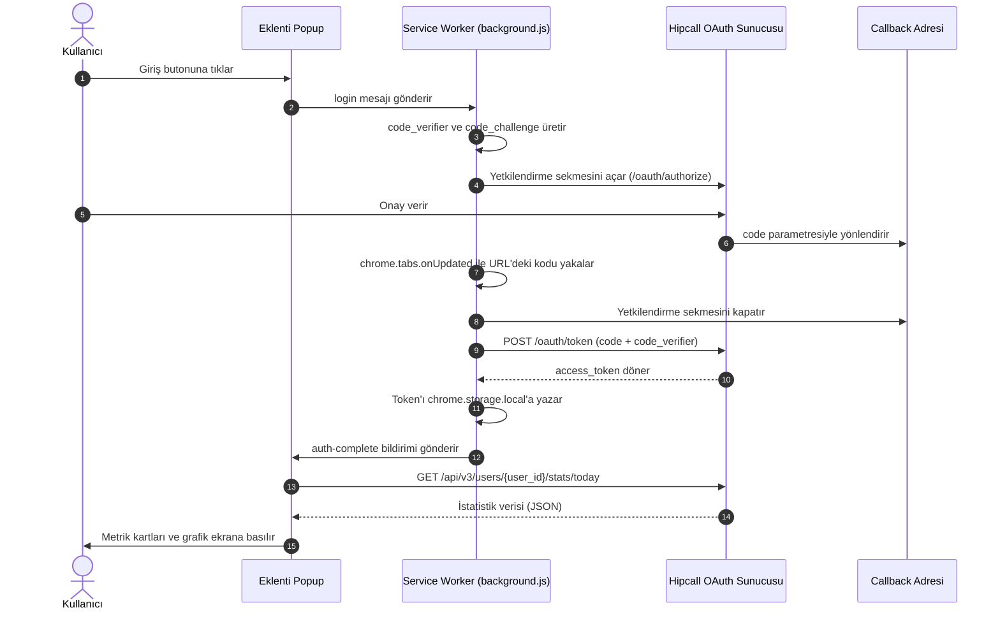

# Hipcall Today Stats & Site Inspector (Chrome Eklentisi - Manifest V3)

Hipcall OAuth 2.0 PKCE akışını kullanarak kullanıcı hesabına bağlanan, günlük istatistikleri (`/api/v3/users/{user_id}/stats/today`) grafik ve metriklerle görüntüleyen ve aktif açık olan web sitelerinden iletişim/iletişim bilgilerini (domain, URL, e-posta, telefon, adres) tarayan Chrome eklentisidir.

## Özellikler

* **Manifest V3 Mimarisi:** Service Worker ve activeTab / scripting izinleri ile güncel Chrome standartlarına tam uyumluluk.
* **OAuth 2.0 PKCE (RFC 7636):** S256 kriptografik doğrulama ile istemci tarafında secret tutmadan güvenli giriş.
* **Otomatik Callback & Oturum Yönetimi:** Yönlendirme sekmesini otomatik kapatma, `chrome.storage.local` üzerinde saklama ve proaktif/reaktif token yenileme (refresh token).
* **Zaman Dağılımı Grafiği:** Günün 24 saatlik durum dağılımını gösteren dairesel halka (SVG Donut) ve yatay zaman çubuğu.
* **Formatlanmış Veri Görünümü:** Türkçe tarih biçimlendirme, saniyeleri saat/dakikaya çevirme ve gelen/giden çağrı metrikleri.
* **Aktif Site Dedektifi (Web Scraper):** O an açık olan sekmedeki domain, temel URL, mailto/tel linkleri, Schema.org JSON-LD verileri, footer ve iletişim sayfalarını tarayarak e-posta, telefon ve adres bilgilerini tek tıkla çıkarma ve panoya kopyalama.
* **Sıfır Bağımlılık:** Vanilla HTML5, CSS3 ve JavaScript ile doğrudan çalışır; build adımı gerektirmez.

## Dosya Yapısı

```text
HipcallExtension/
├── manifest.json       # Eklenti izinleri ve Service Worker tanımı
├── config.js           # API parametreleri ve token fonksiyonları
├── background.js       # PKCE üretimi, sekme/callback dinleyicisi ve Service Worker
├── popup.html          # İstatistikler ve Site Bilgisi sekmelerinin HTML yapısı
├── popup.css           # Arayüz stilleri, grafikler ve scraper kartları
├── popup.js            # Durum yönetimi, grafik render, DOM scraper ve kopyalama mantığı
└── README.md           # Proje dokümantasyonu
```

## OAuth 2.0 + PKCE Akışı



## Kurulum

1. Depoyu klonlayın:
   ```bash
   git clone <REPO_URL>
   ```

2. `config.js` dosyasındaki ilgili alanları doldurun:
   * `clientId`: Hipcall yönetim panelinden alınan Client ID
   * `redirectUri`: Yetkilendirme sonrası dönülecek callback adresi

3. Chrome tarayıcısında `chrome://extensions` adresini açın.

4. "Geliştirici modu"nu aktif edin.

5. "Paketlenmemiş öğe yükle" butonuna tıklayarak `HipcallExtension` klasörünü seçin.

## Kullanım

* **İstatistikler Sekmesi:** Hipcall hesabınıza giriş yaparak günlük çağrı, müsaitlik ve durum sürelerinizi hem grafiksel hem de kartlar halinde inceleyin.
* **Site Bilgisi Çek Sekmesi:** Herhangi bir web sitesinde (örn. bir e-ticaret veya kurumsal site) gezinirken eklentiyi açın ve "Açık Siteden Bilgileri Çek" butonuna basın. Eklenti sayfayı, footer'ı ve iletişim sayfalarını tarayarak domain, temel URL, e-posta, telefon ve adres bilgilerini listeler.
