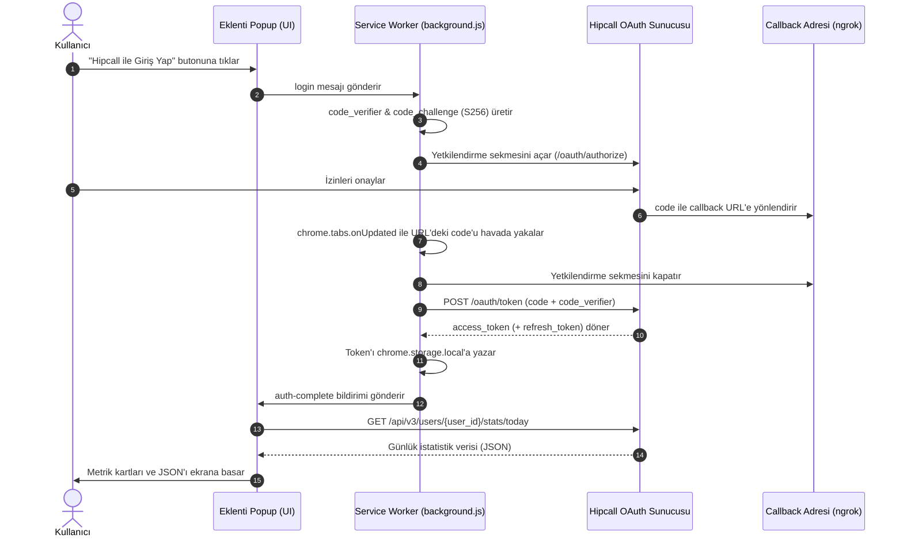

# 📞 Hipcall Today Stats — Chrome Eklentisi (Manifest V3)

Modern, güvenli ve hafif bir Google Chrome eklentisi. **Hipcall OAuth 2.0 (PKCE)** yetkilendirme akışını kullanarak kullanıcı hesabına bağlanır ve kullanıcının günlük istatistiklerini (`TODAY stats`) şık bir karanlık tema arayüzünde görüntüler.

---

## 🚀 Öne Çıkan Özellikler

* **Manifest V3 Mimarisi:** Güncel Chrome uzantı standartlarına tam uyumlu Service Worker yapısı.
* **OAuth 2.0 + PKCE (RFC 7636):** İstemci tarafında `client_secret` ifşa etme riskini ortadan kaldıran, kriptografik doğrulamalı en güncel güvenlik standardı (`S256`).
* **Otomatik Callback & Sekme Yönetimi:** Giriş onaylandığında callback URL'i arka planda yakalanır, geçici auth kodu token ile takas edilir ve açık olan yetkilendirme sekmesi otomatik olarak kapatılır.
* **Token Saklama & Session Yönetimi:** Alınan `access_token` ve `refresh_token` güvenli şekilde `chrome.storage.local` üzerinde saklanır; 401 yetki hatası durumunda otomatik token yenileme denenir.
* **Dinamik user_id Yönetimi:** `user_id` değeri profil endpoint'lerinden otomatik keşfedilir veya popup üzerinden elle girilip yerel hafızaya kaydedilebilir.
* **Sıfır Bağımlılık & Derleme:** Ekstra `npm install` veya `webpack/vite` build adımı gerektirmez. Vanilla HTML5, CSS3 ve JavaScript ile doğrudan çalışır.

---

## 📁 Proje Dosya Yapısı

```text
HipcallExtension/
├── manifest.json       # Eklenti izinleri, metadata ve Service Worker tanımı
├── config.js           # API URL'leri, OAuth parametreleri ve token fonksiyonları
├── background.js       # PKCE üretimi, sekme/callback dinleyicisi ve Service Worker
├── popup.html          # Giriş ve istatistik ekranlarının HTML yapısı
├── popup.css           # Koyu tema, metrik grid ve responsive stiller
├── popup.js            # Durum yönetimi, API istekleri ve DOM etkileşimleri
└── README.md           # Proje tanıtım ve kurulum dokümantasyonu
```

---

## 🔄 OAuth 2.0 + PKCE Çalışma Akışı



---

## 🛠️ Kurulum Adımları

Eklentiyi herhangi bir Chrome tabanlı tarayıcıda (Google Chrome, Brave, Edge vb.) çalıştırmak için:

1. Bu projeyi bilgisayarınıza indirin veya klonlayın:
   ```bash
   git clone <REPO_URL>
   ```

2. Tarayıcınızın adres çubuğuna şunu yazın ve Enter'a basın:
   ```text
   chrome://extensions
   ```

3. Sağ üst köşedeki **"Geliştirici modu" (Developer mode)** anahtarını aktif hale getirin.

4. Sol üstte beliren **"Paketlenmemiş öğe yükle" (Load unpacked)** butonuna tıklayın.

5. Açılan pencerede bu projenin bulunduğu `HipcallExtension` klasörünü seçin.

6. Eklenti simgesine tıklayarak popup'ı açın ve **"Hipcall ile Giriş Yap"** butonuyla test edin.

---

## ⚙️ Yapılandırma (`config.js`)

OAuth ve API parametreleri `config.js` dosyası üzerinden kolayca yönetilebilir:

| Değişken | Açıklama |
| :--- | :--- |
| `baseUrl` | Hipcall API ana adresi (`https://use.hipcall.com.tr`) |
| `authorizeUrl` | OAuth 2.0 izin sayfası URL'i |
| `clientId` | Hipcall Uygulama Yönetiminden alınan Client ID |
| `redirectUri` | Yetkilendirme sonrası dönülecek callback adresi |
| `scope` | Talep edilen izinler (`profile email offline_access contacts:read`) |
| `state` | CSRF koruması için güvenlik anahtarı (`staj123`) |
| `usePKCE` | PKCE doğrulamasının aktifliği (`true`) |
| `tokenExchangeUrl` | Auth kodunun token'a dönüştürüleceği uç nokta |
| `statsPath` | Günlük istatistik endpoint şablonu (`/api/v3/users/{id}/stats/today`) |

---

## 🛡️ Neden PKCE Tercih Edildi?

Geleneksel OAuth2 Authorization Code akışında, istemcinin sunucuya gizli bir `client_secret` anahtarı göndermesi beklenir. Ancak **Chrome eklentileri istemci tarafında (Client-Side) çalışan açık kodlu uygulamalardır**.

* Bir eklentiye gömülen `client_secret`, uzantıyı indiren herkes tarafından düz metin olarak okunabilir.
* **PKCE (RFC 7636)** standardı sayesinde her oturum açılışında anlık dinamik bir şifreleme anahtarı (`code_verifier`) üretilir ve bu anahtarın SHA-256 hash'i (`code_challenge`) sunucuya gönderilir.
* Token takasında sunucu bu anahtarı doğrular. Böylece **hiçbir gizli anahtarı eklenti koduna yazmadan** en üst düzeyde güvenlik sağlanmış olur.
